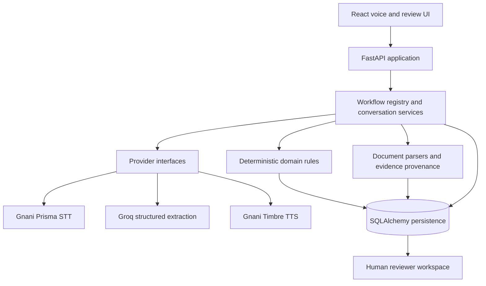

# KuralCredit

> **Voice-first intake. Structured evidence. Human-controlled decisions.**
>
> A multilingual, AI-assisted platform that helps MSMEs clarify loan applications through natural speech, document-backed facts, and transparent human review.

[](https://github.com/kuralcredit/kuralcredit/actions/workflows/ci.yml)


---

## The Problem

For many small businesses, applying for credit means translating everyday business activity into formal financial information.

Revenue may be described in local languages, records may be spread across bank statements and GST summaries, and apparent differences often need context—not assumptions.

KuralCredit is designed to make that clarification process more accessible and auditable.

## What It Does

KuralCredit combines speech interfaces, structured extraction, deterministic validation, and evidence provenance in one review-oriented workflow:

1. **Speak naturally** — capture an applicant's declaration through the browser.
2. **Transcribe and confirm** — use Gnani Prisma STT, then let the applicant review and correct the transcript.
3. **Extract candidate facts** — use Groq-hosted `openai/gpt-oss-120b` to map confirmed text into a typed workflow schema.
4. **Validate deterministically** — normalize Indian monetary expressions with Python `Decimal`; apply explicit domain rules rather than asking an LLM to perform financial arithmetic.
5. **Clarify differences** — identify missing or inconsistent evidence in neutral language and generate follow-up questions; Gnani Timbre TTS can speak those questions.
6. **Prepare for review** — organize declared facts, document-derived values, provenance, and audit history into a reviewer-facing application record.

## Built-in Workflows

| Workflow | Purpose | Example Information Captured |
|---|---|---|
| `loan_application` | Reference workflow for MSME loan clarification | Business context, sales declarations, GST turnover, bank credits, supporting records |
| `customer_support_intake` | Second workflow demonstrating reuse of the conversation pipeline | Customer issue, affected product/service, urgency, contact preference, troubleshooting steps |

The customer-support workflow is exercised through the same conversation and review pipeline.

These are the two workflows currently bundled with the application; this repository is **not** a no-code workflow builder. Adding another workflow currently involves defining and registering it in the codebase, and implementing an approved rule plugin when domain-specific logic is required.

## Architecture



### Engineering Principles

- **Provider isolation:** STT, TTS, and reasoning are accessed through provider interfaces.
- **Explicit execution modes:** `real` calls configured providers; `mock` uses deterministic local adapters for offline development and demos. Real mode does not silently fall back to mocks.
- **Structured extraction:** Model output is validated against typed schemas before application logic consumes it.
- **Deterministic financial logic:** Monetary handling uses `Decimal`; LLM output is treated as a candidate, not verified truth.
- **Evidence provenance:** Facts retain their source and review state so declarations, document values, and system-derived values remain distinguishable.
- **Human authority:** The system prepares information for authorized people; it does not make lending decisions.

## Technology Stack

| Layer | Technologies |
|---|---|
| Backend API | Python 3.11+, FastAPI, Pydantic v2, SQLAlchemy 2, Alembic |
| Speech AI | Gnani Prisma STT, Gnani Timbre TTS |
| Reasoning | Groq API, `openai/gpt-oss-120b`, structured output validation |
| Documents | CSV, PDF, and XLSX parsing with Python libraries |
| Frontend | React 19, TypeScript, Vite, CSS Modules |
| Persistence | SQLAlchemy; SQLite by default, configurable through `DATABASE_URL` |
| Testing | pytest, Vitest, ESLint, Ruff, deterministic evaluation scripts |

---

## Getting Started

### Prerequisites

- Python **3.11+** (3.12 recommended)
- Node.js **20+** and npm
- Gnani and Groq API credentials for real provider mode

### 1. Clone the Repository

```bash
git clone https://github.com/kuralcredit/kuralcredit.git
cd KuralCredit

python -m venv .venv
```

Activate the environment:

```bash
# macOS / Linux
source .venv/bin/activate

# Windows PowerShell
.venv\Scripts\Activate.ps1
```

### 2. Configure Environment Variables

Create a local environment file:

```bash
# macOS / Linux
cp .env.example .env

# Windows PowerShell
Copy-Item .env.example .env
```

Edit `.env` locally.

**Never commit `.env` or expose API keys in source files.**

For an offline demo:

```dotenv
APP_ENV=development
PROVIDER_MODE=mock
```

For real provider calls:

```dotenv
APP_ENV=development
PROVIDER_MODE=real
GNANI_API_KEY=<your-gnani-api-key>
GROQ_API_KEY=<your-groq-api-key>
```

Keep provider credentials on the backend. Configure a strong, unique `SECRET_KEY` and reviewer credentials before exposing the reviewer portal.

### 3. Install Dependencies

```bash
# Backend
python -m pip install --upgrade pip
pip install -e "backend[dev]"

# Frontend
npm ci
```

### 4. Verify Configuration

```bash
python scripts/check_config.py
```

This checks local settings, the upload directory, and database connectivity.

It does **not** prove that external AI providers are reachable.

### 5. Build the Frontend

```bash
npm run build
```

### 6. Start the Application

```bash
python -m uvicorn app.main:app --app-dir backend --host 127.0.0.1 --port 8000 --reload
```

Open:

**http://127.0.0.1:8000**

Interactive API documentation:

**http://127.0.0.1:8000/docs**

### Frontend Development Mode

For hot reload, keep the backend running on port `8000` and start Vite in another terminal:

```bash
npm run dev
```

Open **http://localhost:5173**.

Vite proxies `/api` requests to the backend.

### Docker

After creating and configuring `.env`:

```bash
docker compose up --build
```

Open **http://localhost:8080**.

Stop the stack:

```bash
docker compose down
```

---

## Provider Modes and Verification

KuralCredit supports two explicit provider modes:

| Mode | Behavior | Intended Use |
|---|---|---|
| `real` | Uses Gnani STT/TTS and Groq reasoning adapters. Provider or credential failures surface as errors; no mock fallback is presented as a real response. | Live integration and demonstrations with valid credentials |
| `mock` | Uses deterministic local speech/reasoning adapters. Outputs are demo/test data, not provider-generated results. | Offline development, automated tests, and rehearsals |

Run live provider smoke tests only when valid credentials are configured and you intend to make real external API calls:

```bash
python scripts/run_provider_smoke_tests.py --live
```

The runner checks:

- Gnani Prisma STT
- Gnani Timbre TTS
- Groq reasoning

It reports `PASS`, `FAIL`, or `BLOCKED`.

The smoke runner is separate from the offline test suite. A passing unit test or deterministic benchmark does **not** prove live provider connectivity.

Re-run the smoke tests in the environment used for the demonstration and retain the actual output as verification evidence.

## Testing and Quality Checks

### Backend

```bash
python -m ruff check backend scripts
python -m pytest backend/tests -q
python scripts/run_evaluation.py
```

### Frontend

```bash
npm --workspace frontend run lint
npm --workspace frontend run typecheck
npm --workspace frontend run test -- --run
npm --workspace frontend run build
```

### Submission Readiness

```bash
python scripts/verify_submission.py
```

The readiness verifier covers local checks and secret scanning. It does **not** make live Gnani or Groq API calls.

The deterministic evaluation benchmark tests parsing, rules, safety checks, and explicit mock-adapter behavior. Its score must not be interpreted as live LLM accuracy.

### Create a Clean Release

```bash
python scripts/package_submission.py
```

The allowlist-based packager generates:

```text
release/KuralCredit_Source_Release.zip
```

It also generates release manifests.

Review the generated archive before sharing it. Rotate any credential that has ever been exposed, even if the file containing it has since been removed.

---

## API Surface

The API is versioned under `/api/v1`.

| Endpoint | Purpose |
|---|---|
| `GET /api/v1/health` | Application health |
| `GET /api/v1/health/ready` | Readiness status |
| `GET /api/v1/capabilities` | Configured speech/provider capabilities |
| `GET /api/v1/workflows` | List bundled workflows |
| `GET /api/v1/workflows/{workflow_id}` | Retrieve a workflow definition |
| `POST /api/v1/workflows/validate` | Validate a workflow definition |
| `POST /api/v1/speech/transcribe` | Transcribe uploaded audio |
| `POST /api/v1/speech/synthesize` | Synthesize speech |

Explore the complete API through the interactive OpenAPI documentation at `/docs`.

## Responsible AI and Human Review

KuralCredit is an **application clarification and evidence-preparation tool**.

It is not a lender, credit bureau, underwriting engine, or fraud detector. It does not produce credit scores or automatically approve or reject applications.

Key safeguards:

- Bank credits are not automatically assumed to be revenue.
- Missing financial values are not invented.
- Discrepancies are presented as items requiring context, not proof of fraud.
- Extracted facts remain subject to applicant correction and authorized human review.
- Consequential lending decisions remain with authorized human reviewers.
- Use synthetic records for demonstrations. Do not upload real applicant or financial data into an unapproved environment.

## Repository Structure

```text
backend/
  app/
    api/                 Versioned FastAPI routes
    core/                Settings, security, lifecycle, logging
    domain/              Financial primitives, provenance, workflow schemas
    document_parsers/    CSV, PDF, and XLSX parsers
    providers/           Gnani, Groq, and explicit mock adapters
    services/            Conversation, extraction, evidence, review services
    models/              SQLAlchemy models
  tests/                 Backend unit and integration tests

frontend/
  src/
    components/          Voice, application, document, and reviewer UI
    pages/               Applicant and reviewer pages
    hooks/               API/query and recording hooks

scripts/                  Verification, evaluation, and release tooling
docs/                     Architecture, API, security, and integration guides
```

## Documentation

- [Architecture](docs/ARCHITECTURE.md)
- [System Architecture](docs/SYSTEM_ARCHITECTURE.md)
- [API Contracts](docs/API_CONTRACTS.md)
- [Gnani Integration](docs/GNANI_INTEGRATION.md)
- [Groq Integration](docs/GROQ_INTEGRATION.md)
- [Security and Privacy](docs/SECURITY_AND_PRIVACY.md)
- [AI Evaluation Methodology and Limitations](docs/AI_EVALUATION.md)
- [Demo Script](docs/DEMO_SCRIPT.md)

## License

Released under the [MIT License](LICENSE).
