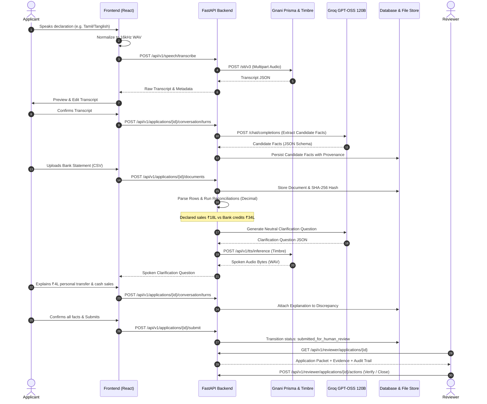

# KuralCredit — Data Flow & Lifecycle

---

## Data Provenance States

Every financial data point maintains an explicit lifecycle:

| Provenance State | Meaning | Source |
|---|---|---|
| `candidate` | Extracted by AI from speech or unstructured notes; not yet confirmed. | Groq extraction from speech |
| `applicant_confirmed` | Applicant has reviewed, corrected (if needed), and confirmed the figure. | Applicant confirmation |
| `document_extracted` | Extracted deterministically or via AI from an uploaded document. | CSV / XLSX / PDF parser |
| `reviewer_verified` | A human underwriter has reviewed evidence and verified the figure. | Reviewer action |
| `rejected` | Explicitly marked invalid or rejected with recorded justification. | Reviewer / Applicant action |

